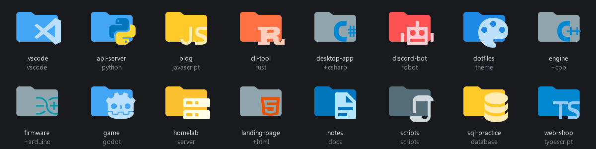
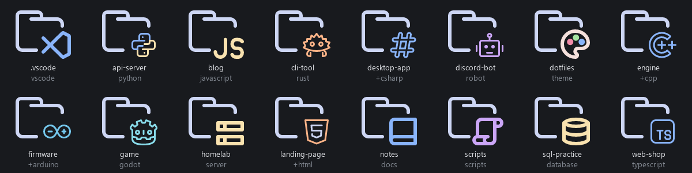
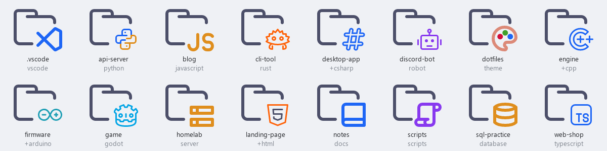

# folder-icons

VS Code icon-theme folder icons for Windows Explorer. Point it at a folder full of projects, and every project gets an icon that says what it is. The icons come from [Material Icon Theme](https://github.com/material-extensions/vscode-material-icon-theme) or [Catppuccin Icons](https://github.com/catppuccin/vscode-icons), and you can switch between the sets with one command.





The icons also show up in Explorer's navigation pane. Everything the tool writes can be removed with one command.

## Requirements

- Windows 10 or 11 (Explorer reads folder icons from `desktop.ini`)
- Python 3.10+ with [Pillow](https://pypi.org/project/Pillow/)
- Node.js 18+ (renders the SVG icons through [resvg](https://github.com/yisibl/resvg-js))
- Git (fetches the icon sets)

## Install

```
git clone https://github.com/PantoYT/folder-icons
cd folder-icons
pip install pillow
npm install
python folder_icons.py fetch
python folder_icons.py selftest
```

`fetch` sparse-clones only the icon directories of both themes into `.material/` and `.catppuccin/`. Run it again later to update them.

## Use

Look before you touch anything:

```
python folder_icons.py list    D:\Projects          # what each folder is detected as
python folder_icons.py preview D:\Projects          # contact sheet in preview.png, nothing written
```

Apply, then press F5 in Explorer:

```
python folder_icons.py apply D:\Projects
python folder_icons.py apply D:\Projects --deep 3   # also subfolders like docs, src, .github
```

Switch the icon set on everything you applied:

```
python folder_icons.py use catppuccin          # Catppuccin Mocha
python folder_icons.py use catppuccin-latte    # light flavor
python folder_icons.py use material
```

Take it all back:

```
python folder_icons.py undo D:\Projects
```

If Explorer keeps showing old icons, run `ie4uinit.exe -show` or restart Explorer.

## How a folder gets its icon

**Project folders**, the direct children of the root, are detected:

1. **Marker files win:** `project.godot`, `Cargo.toml`, `*.csproj`/`*.sln`, `*.ino`/`*.kicad_pcb`/`platformio.ini`, `tsconfig.json`, `package.json`.
2. **Otherwise the tool counts source files** up to three levels deep. It skips `node_modules`, `.git`, `venv`, `dist` and similar. Shell scripts, HTML and SQL only win when nothing heavier is present.
3. **Folders starting with `_` count as archives.** Folders with only Markdown, text or PDFs count as docs.

**Dot folders** at the top level (`.vscode`, `.claude`, `.github`) and, with `--deep N`, **subfolders up to depth N** get an icon only when their name is in the theme's own folder-name map. That is the same map that colors `docs`, `src` or `tools` in VS Code. There is no guessing: a folder whose name is not in the map keeps the normal Windows icon. Names match with `.`, `_` and `__x__` variants.

`--deep` never icons or enters build output, caches and logs (`dist`, `build`, `bin`, `obj`, `temp`, `coverage`, `logs`, `cmake-build-*`). See the warning below.

## Overrides

Detection gives the language. Overrides let you pick an icon by what a project *is*. Copy `config.example.json` to `config.json` (gitignored):

```json
{
  "folders": {
    "discord-bot": {"icon": "folder-robot"},
    "homelab":     {"icon": "folder-server"},
    "notes":       {"kind": "docs"},
    "firmware":    {"icon": "+arduino"},
    "vendor-sdk":  {"shallow": true},
    "tmp":         {"skip": true}
  }
}
```

| key | effect |
|---|---|
| `icon` | an icon spec (see below) |
| `kind` | force a detected kind: `python`, `javascript`, `typescript`, `web`, `godot`, `csharp`, `cpp`, `java`, `php`, `rust`, `hardware`, `script`, `sql`, `docs`, `archive` |
| `shallow` | keep `--deep` out of this project |
| `skip` | leave the folder alone |

An icon spec uses Material's vocabulary:

- `folder-<name>`: a Material folder icon. `python folder_icons.py icons` lists all ~280 names.
- `+<name>`: the file icon `<name>.svg` on a plain folder. Use it for languages without a folder icon, like `+cpp`, `+csharp` or `+arduino`.

Catppuccin has fewer folder icons (~110), so each spec is translated in this order:

1. the same folder (also its plural, singular, or an alias in `CAT_FOLDER_ALIAS`);
2. the concept's file icon on an outline folder (`python`, `typescript`, ...);
3. Catppuccin's folder for any folder name Material maps to that icon;
4. a plain outline folder.

## What apply changes on disk

- **One `desktop.ini` per iconed folder,** hidden and system. Its first line carries a marker, so `undo` removes only files this tool wrote.
- **The folder's read-only attribute.** Explorer ignores `desktop.ini` without it. The previous state is stored in `icons/applied.json`, and `undo` restores it.
- **A folder that already has its own `desktop.ini` is skipped.** With `--force`, that file is backed up to `desktop.ini.folder-icons-bak` and restored on `undo`.
- **Rendered `.ico` files** go to `icons/<set>/`, one directory per set. Switching back to a set you used before is instant, and Explorer's icon cache cannot mix up sets. The root, depth and set of the last `apply` are kept in `icons/state.json` for `use`.

`desktop.ini` paths are absolute and point into this folder's `icons/`. If you move the tool, run `apply` again.

### Things to know

- **Git:** every iconed repository gains an untracked `desktop.ini`. Add it to your global gitignore:
  `git config --global core.excludesfile` shows the file, then add a `desktop.ini` line to it.
- **Python's `shutil.rmtree` cannot delete a read-only folder** on Windows ("Access is denied"). PowerShell, cmd, Node and `rm -rf` can. This is why `--deep` stays out of folders that build tools delete and recreate. If a Python script of yours deletes iconed folders, run `undo` first or leave that project `shallow`.
- **The icons render on your machine** from the theme repositories, and this repository does not ship them.

## License

MIT for this tool, see [LICENSE](LICENSE). The icons belong to Material Icon Theme (MIT, (c) Material Extensions) and Catppuccin Icons (MIT, (c) Catppuccin), and are fetched at setup time.
